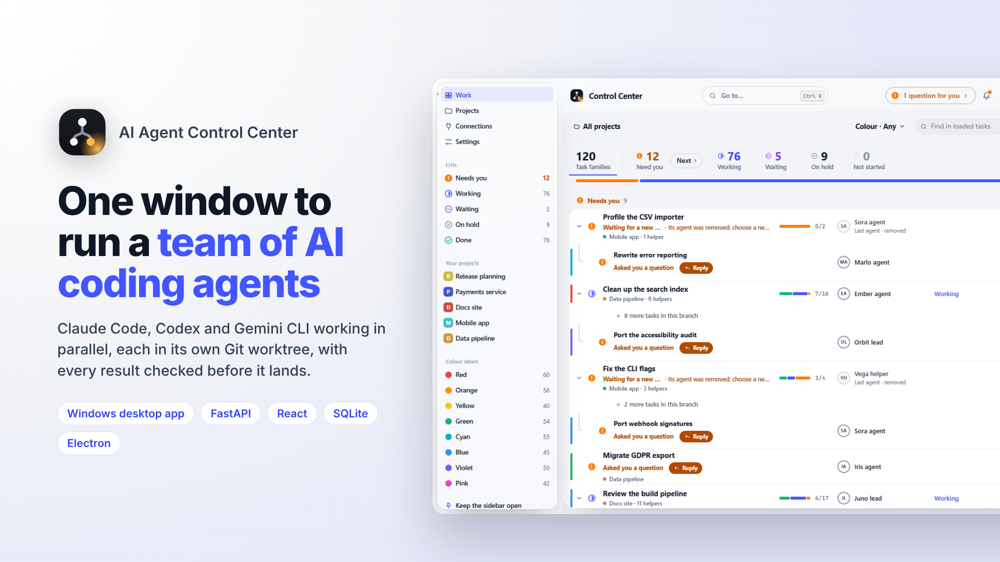
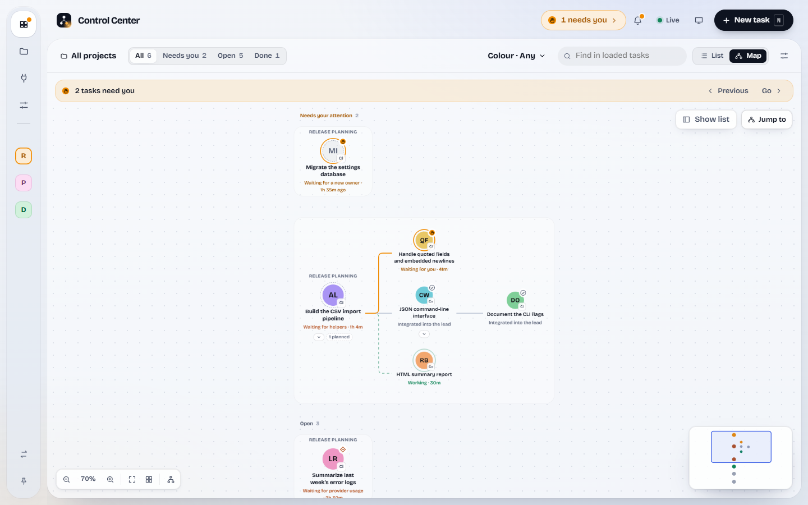
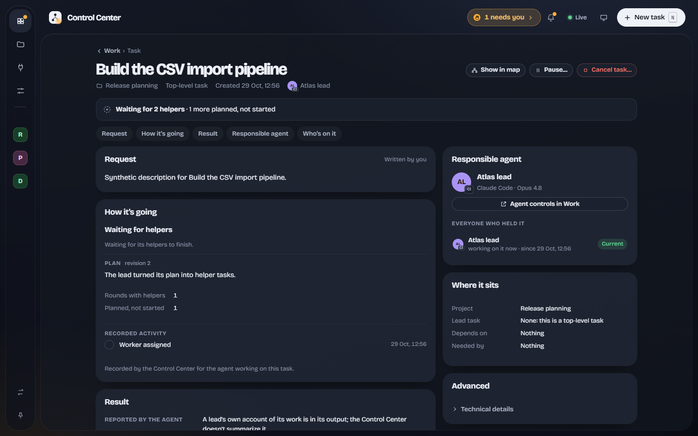
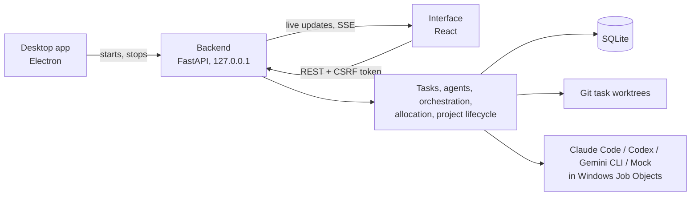

# AI Agent Control Center

**A Windows desktop app for running AI coding agents on your own projects, watching what each one
is doing, and stepping in when they need you.**

You describe the work in plain language. The Control Center starts an agent (Claude Code, Codex or
Gemini CLI, on your own account) in a private Git worktree, shows its progress live, lets you answer
its questions, redirect it or stop it, and keeps a durable record of everything that happened. A lead
agent can bring in helper agents for parts of the work; the backend decides what may start, and every
helper's result comes back through conflict-checked integration.



<table>
  <tr>
    <td width="50%"></td>
    <td width="50%"></td>
  </tr>
  <tr>
    <td><sub>The Work Map, left to right: each family on its own tray, light along the lines to working agents.</sub></td>
    <td><sub>A task page in the dark appearance.</sub></td>
  </tr>
</table>

<sub>Screenshots of the built interface with synthetic data (no real project or model run). See
[verification](#status) for what was tested with real providers.</sub>

## Video demo

https://github.com/user-attachments/assets/ef86b56f-d75c-4235-8612-5d25ad88af97

## What this project demonstrates

- **Systems design under concurrency:** several AI agents work in parallel on the same repository
  without stepping on each other: per-task Git worktrees, admission limits, journaled and
  conflict-checked integration, and recovery after crashes.
- **Reliable process control on Windows:** every agent runs inside a Job Object, so stopping,
  crashing or closing the app never leaves an orphaned process.
- **Security for a local API:** Host and Origin checks, a per-process CSRF token and side-effect-free
  reads keep a web page from driving the backend.
- **Product and interface craft:** a desktop interface designed for hundreds or thousands of tasks,
  with a List and a delegation Map, live updates, full keyboard access, light and dark appearances,
  reduced-motion support and automated accessibility checks.
- **Testing discipline:** backend, interface and browser suites against temporary databases, real
  Git repositories and fake provider CLIs.

## Highlights

- **One place to steer every agent.** A Work list and a Work Map of every task family, a sidebar of
  smart lists (Needs you, Working, Waiting, On hold, Done) and colour labels, and replies, redirects,
  stops and resumes from the same window. Every state reads at a glance: a word, a familiar symbol
  and one colour, and only agents that are really working are drawn in light.
- **Isolation by default.** Each task works in its own Git worktree; your folder is never edited
  directly, and results come back only through journaled, conflict-checked integration.
- **Explicit access levels.** Read only, Workspace or Full Access, mapped to each provider's own
  controls and explained per tool before anything starts. Helpers never inherit Full Access
  unless you allow it. ([agent access](docs/agent-access.md))
- **Projects you can organize.** Rename, reorder by drag or keyboard, hide, move to a real Trash,
  restore, or delete permanently with safety checks that never follow links or touch remotes.
  ([project lifecycle](docs/project-lifecycle.md))
- **A real Windows app.** A per-user installer, its own backend on a free local port, a first-run
  guide, a demo mode with synthetic projects, and a clean shutdown that leaves nothing running.
  ([desktop app](docs/desktop.md))
- **Durable and supervised.** SQLite state that survives restarts, and every agent process in a
  Windows Job Object, so Stop, a crash or a shutdown never leaves an orphaned process.

## Install (Windows)

No release is published yet; the installer is built from this repository.

```powershell
.\desktop\build.ps1
```

Then run `desktop\out\AI-Agent-Control-Center-Setup-0.15.0.exe`. It installs for your Windows user
(no administrator rights) and opens straight into the app; there is nothing else to start. The
installer is not code-signed, so SmartScreen asks before the first run. To look around without a
project or any model usage, start the app with `--demo`.

The build needs Python 3.11+, Node.js 22.13+ and Git. To run the backend and the interface from
source instead, see [Run from source](docs/getting-started.md).

New to the app? [How to use the Control Center](docs/USER_GUIDE.md) walks through adding a project,
starting a task, answering agents and applying results to your folder.

To try the repository's current code without building an installer, double-click
`scripts\start-dev.cmd`. It opens the development version (marked **Dev**) at
http://127.0.0.1:5180 with its own data, separate from the installed app. See
[Development launcher](docs/getting-started.md#development-launcher).

## How it works



The backend owns every decision: admission, supervision, integration and recovery. Provider CLIs
receive the prompt on standard input and only validated, fixed options as arguments. Agents run on
the CLI you installed and signed in to; the Control Center holds no credentials and removes
paid-route API keys from every agent's environment.

| Problem | Approach |
| --- | --- |
| Agents claiming work they did not do | Control messages are accepted only from validated, completed structured events; prose and tool output cannot request delegation or accept results. ([delegations](docs/delegations.md)) |
| Ownership after crashes and replacements | Work is owned by task assignments and execution generations; stale workers cannot write, and uncertain launches wait for recovery instead of a blind retry. ([task lifecycle](docs/task-lifecycle.md)) |
| Parallel agents editing the same code | Per-task worktree snapshots, freshness checks, staged and journaled integration that refuses conflicts. ([workspaces](docs/workspaces.md)) |
| Unbounded fan-out | Depth, capacity, concurrency and scope-overlap limits checked at every admission. ([delegations](docs/delegations.md#depth-and-operational-bounds)) |
| Orphaned processes | Job Objects kill a whole tree on Stop, shutdown or crash; launches fail closed without supervision. ([process supervision](docs/process-supervision.md)) |
| A local API reachable from the browser | Host and Origin checks, a per-process CSRF token, JSON-only bodies, side-effect-free reads. ([API security](docs/api-security.md)) |

**Stack:** Python, FastAPI and SQLite (no ORM, no task queue); React 19 and Vite with plain CSS;
Electron and PyInstaller for the desktop app. About 1,700 backend tests, 220 interface unit tests
and 190 browser tests run against temporary databases, real temporary Git repositories and fake
provider CLIs.

## Status

An engineering project under active development, for Windows; not a production service.

| Provider | Verified |
| --- | --- |
| OpenAI Codex CLI | Real runs, including an autonomous lead with two helpers integrated and accepted end to end. |
| Anthropic Claude Code | One short authenticated run; delegation and limit recovery tested with fake CLIs. |
| Google Gemini CLI | Fake CLIs only. Personal Google accounts are no longer served by Gemini CLI. |
| Mock | Simulated work for exploring the app; no model is used. |

Full Access and the Workspace level's command and network behaviour are verified only against fake
CLIs; [agent access](docs/agent-access.md#what-is-verified-and-what-still-needs-a-real-run) lists
what still needs an authenticated run. Real agents use your own provider plan, and the app has no
spending budget. More in [limitations](docs/lumen-parity.md#not-done-yet) and [providers](docs/providers.md).

## Documentation

| | |
| --- | --- |
| [Desktop app](docs/desktop.md) | Behaviour, data locations, build and verification |
| [Run from source](docs/getting-started.md) | Backend and interface for development, first project, first agent, checks |
| [Interface](docs/lumen-parity.md) | What the interface does, its visual language, and what is not done yet |
| [Agent access](docs/agent-access.md) | Read only, Workspace and Full Access per provider, and the audit |
| [Project lifecycle](docs/project-lifecycle.md) | Rename, order, hide, Trash, restore and permanent deletion |
| [Providers](docs/providers.md) | Readiness, billing, models and effort, Auto allocation, setup |
| [Delegations](docs/delegations.md) and [planning](docs/planning.md) | How a lead brings in helpers, and how results come back |
| [Task lifecycle](docs/task-lifecycle.md), [workspaces](docs/workspaces.md), [resources](docs/resource-coordination.md) | Ownership, isolation, integration and coordination |
| [Process supervision](docs/process-supervision.md) and [API security](docs/api-security.md) | Containment, recovery and the local API's guards |
| [Configuration](docs/configuration.md) | Environment variables and troubleshooting |

[AGENTS.md](AGENTS.md) holds the rules coding agents follow in this repository.

## License

Released under the [MIT License](LICENSE). The software is provided as is, without warranty. Using
real agents also falls under the terms of the provider you use.
