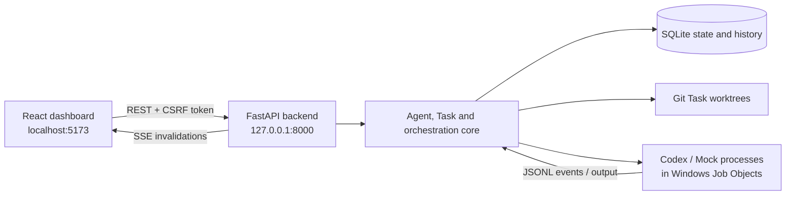

# AI Agent Control Center

A local dashboard for running and supervising AI coding agents on your own machine. You describe the work in plain language. The Control Center starts the agent in an isolated Git workspace, streams its output, lets you answer its questions or stop it, and keeps a durable record of what happened.

In autonomous mode, a Codex agent can split a request into separate responsibilities. The Control Center then admits **Child agents** under explicit limits and gives each one its own workspace. It integrates their results back into the Parent's workspace, and the Parent must review and accept each result before it can finish.

> **Status:** an open-source, actively developed engineering project that you run locally. It is not a production service. It runs locally on Windows and supports one real provider, the [OpenAI Codex CLI](https://github.com/openai/codex), plus a Mock provider for exploring the UI without model usage. See [limitations](#security-and-limitations).

## Why it exists

Running several coding agents in separate terminals breaks down quickly. It becomes hard to see which agent is waiting for you, two agents can edit the same files, and nobody records which output was actually reviewed or merged. If a terminal closes, its history is gone.

The Control Center puts that work behind one local backend:

- **One place to watch and steer.** Every agent's status, output and pending question is in one dashboard. You can reply, redirect, stop a single agent or stop a whole branch of agents.
- **Isolation by default.** Each Task gets its own Git worktree snapshot, so agents never edit your checkout directly.
- **Explicit hand-offs.** Child results are integrated only through conflict-checked, journaled steps and explicit acknowledgement, never by trusting an agent's claim that it is done.
- **Durable state.** Tasks, assignments, plans, delegations, integrations and output live in SQLite and survive backend restarts.

## What it does

**Dashboard (React)**
- Register an existing local Git repository as a Project, then start Mock or Codex agents against it. Codex runs in the `read-only` (default) or `workspace-write` sandbox.
- Follow live status over Server-Sent Events, with polling as a fallback, and browse paginated output history.
- Reply to a waiting agent, redirect a running one, delegate routine decisions to it, or stop an agent or its whole subtree.
- Explore an agent's family in a three-pane hierarchy view that shows Task state, planning decisions, Child outcomes, integration evidence and recent activity.
- Use an attention panel for agents that need you, light and dark themes, and optional browser or Windows notifications.

**Autonomous orchestration (Codex)**
- The Parent records an orchestration decision: work independently with a rationale, or propose separate Child responsibilities with their dependencies.
- Proposals are promoted through a strict JSON protocol. The backend alone decides admission, applying depth, capacity, scope-overlap, resource and lifecycle checks.
- Codex's own built-in multi-agent tools are disabled for these runs, so every Child goes through Control Center admission.
- Children run in workspaces derived from their Parent. Their results are integrated into the Parent's workspace and delivered for review. The Parent cannot complete until it accepts or rejects each result.

**Backend foundations (mostly API-only)**
- Durable Task and Agent identities, so work survives a worker being replaced.
- Pause, resume and cancel with subtree impact, dependencies and durable blockers.
- Resource claims with fair queues and deadlock detection, plus logical work-intent scopes that detect overlapping responsibilities.
- On Windows, every agent process tree runs inside a Job Object, which makes Stop reliable even for detached descendants.

A real autonomous run has been verified end to end. A natural-language request led one Parent to promote two Children. Both Children completed, both results were integrated and accepted, and the Parent finished after its own test run passed. The [verification notes](docs/dashboard.md#verification) list exactly what was and was not covered.

## Architecture



- **Frontend:** React 19, Vite 8 and plain CSS. Tests run on Node's built-in test runner.
- **Backend:** Python, FastAPI, Uvicorn, SQLite and standard-library process and thread management. The backend has no ORM and no task queue.
- **Providers:** Codex runs as `codex exec --json`. The prompt is sent on stdin, and only validated, fixed CLI options are passed as arguments.
- **Single process:** run one backend process. Live process registries and the event broker are in memory.

## Engineering highlights

These are the problems that took most of the design work. The linked documents explain the invariants in detail.

| Problem | Approach |
| --- | --- |
| Agents claiming work they did not do | The adapter accepts control messages only from validated, completed JSONL assistant events. Prose, tool output, stderr and code fences cannot request delegation or acknowledge results. See [delegations](docs/delegations.md). |
| Ownership after crashes and replacements | Work is owned by Task assignments and execution generations. Stale workers cannot write, and uncertain launches are marked `recovery_required` instead of being retried blindly. See [task lifecycle](docs/task-lifecycle.md). |
| Parallel agents editing the same code | Each Task gets a detached worktree snapshot. Integration checks freshness, stages changes outside the destination, keeps a journal and refuses conflicts. See [workspaces](docs/workspaces.md). |
| Unbounded multi-agent fan-out | Depth, unfinished-Children and concurrency limits are checked at every admission and launch, together with per-tree round rate limits and non-overlapping responsibility scopes. See [delegations](docs/delegations.md#depth-and-operational-bounds). |
| Orphaned processes | Each execution runs in a Windows Job Object that kills its whole tree on Stop, shutdown or backend crash, and launch fails closed if supervision cannot be established. See [process supervision](docs/process-supervision.md). |
| Local API exposed to the browser | Host and Origin checks, a per-process CSRF token and JSON-only bodies block other websites. GET requests have no side effects. See [API security](docs/api-security.md). |

## Quick start (Windows)

The commands below are PowerShell. Run them in order: each block assumes the directory left by the previous one.

### 1. Prerequisites

- **Windows 10 or 11.** Real-agent launching and process supervision are Windows-only.
- **Git**, on `PATH`, with `user.name` and `user.email` configured.
- **Python 3.11 or newer**, available as `python`.
- **Node.js 22.13+ or 24+**, with npm.
- **For real agents only:** an OpenAI account that can use Codex. Mock mode needs no account.

Check what you have:

```powershell
git --version
python --version
node --version
npm --version
```

### 2. Clone the repository

Choose a parent folder, for example your home directory:

```powershell
cd $HOME
git clone https://github.com/amit22882036-ship-it/ai-agent-control-center.git
cd .\ai-agent-control-center
```

The rest of the setup runs from this repository root.

### 3. Create the Python virtual environment

```powershell
python -m venv .venv
```

The commands below call `.venv\Scripts\python.exe` directly, so you do not need to activate the environment.

### 4. Install backend dependencies

```powershell
.\.venv\Scripts\python.exe -m pip install -r backend\requirements.txt
```

### 5. Install frontend dependencies

```powershell
cd .\frontend
npm ci
cd ..
```

### 6. Install and sign in to your own Codex CLI (real agents only)

The Control Center uses whatever Codex account is signed in on **your** machine. It contains no credentials and gives no access to anyone else's account. Model usage is billed to, or counted against, your own plan.

```powershell
npm install -g @openai/codex
codex login
codex login status
```

`codex login` opens a browser so you can sign in. The backend launches Codex through npm's global launcher at `%APPDATA%\npm\codex.cmd`, which is where `npm install -g` puts it by default. If you changed npm's global prefix, real agents will report that Codex was not found. The integration was tested with Codex CLI 0.154.0.

No Control Center configuration is required. If your account cannot use the CLI's default model, see the optional [model settings](docs/configuration.md#codex-model-and-reasoning-effort).

### 7. Start the backend (window 1)

Open a PowerShell window in the repository root and keep it running:

```powershell
cd .\backend
..\.venv\Scripts\python.exe -m uvicorn app.main:app --host 127.0.0.1 --port 8000
```

When Uvicorn prints `Application startup complete`, the API is ready. You can confirm it at <http://127.0.0.1:8000/health>.

### 8. Start the frontend (window 2)

Open a **second** PowerShell window in the repository root and keep it running:

```powershell
cd .\frontend
npm run dev -- --host 127.0.0.1 --port 5173 --strictPort
```

### 9. Open the dashboard

Go to <http://127.0.0.1:5173>.

The two ports do different jobs:

| Port | What runs there | Used for |
| --- | --- | --- |
| `5173` | Vite dev server for the React dashboard | The page you open in the browser |
| `8000` | FastAPI backend | REST API, live events, local API docs at `/docs` |

The dashboard always calls the backend at `127.0.0.1:8000`, so the backend must run on that port. Both servers listen only on `127.0.0.1`.

### 10. Register an existing Git project

Agents work on a registered Project, which must be an existing Git repository with at least one commit. For a first try, create a small sandbox repository in a third window:

```powershell
mkdir $HOME\control-center-sandbox
cd $HOME\control-center-sandbox
git init
Set-Content README.md "# Sandbox"
git add README.md
git commit -m "Initial commit"
```

In the dashboard, choose **New agent**, then **Add existing project**. Enter a name and the repository's absolute path, for example `C:\Users\<you>\control-center-sandbox`, and choose **Register project**.

Agents never edit this folder directly. Each Task works in its own snapshot under `%LOCALAPPDATA%\AI Agent Control Center\task-workspaces`, and changes come back only through integration.

### 11. Start a Mock agent

In **New agent**, select your Project and choose **Mock**. Enter any short assignment and start the agent. Mock agents simulate progress and output so you can try Stop, the output view and the hierarchy. They do not run the assignment and use no model.

### 12. Start a real Codex agent

In **New agent**, choose **Codex** and keep the **Read only** sandbox for a first run. Turn **Autonomous mode** off unless you want the agent to be able to create Child agents. It is on by default for new Codex root agents, and autonomous runs can use noticeably more model usage. Enter a request in plain language, for example:

```text
Summarize what this repository contains and suggest one small improvement.
```

Choose **Workspace write** only when you want the agent to change files in its isolated Task workspace.

### Stopping and restarting

Press `Ctrl+C` in each window, then run the commands from steps 7 and 8 again. Stopping the backend also stops any running agents. History stays in the database, but running work does not resume automatically.

If the backend window ever had environment variables set for an experiment, such as `CONTROL_CENTER_DB_PATH` for a test database or the delegation limits, the dashboard will use those settings until they are cleared. Before restarting the backend for normal use, check:

```powershell
Get-ChildItem Env:CONTROL_CENTER_*
```

Clear any you did not intend to keep, for example `Remove-Item Env:CONTROL_CENTER_DB_PATH`, or open a new PowerShell window. [Troubleshooting](docs/configuration.md#troubleshooting) covers port conflicts and other common problems.

## Configuration

Everything has a working default, and environment variables are read by the backend at startup. You can relocate the database or the workspace root, override the Codex model and reasoning effort, and tighten delegation limits. All settings are listed in [configuration and troubleshooting](docs/configuration.md).

## Security and limitations

- **Local and single-user.** The backend has no user authentication. Its [local API guards](docs/api-security.md) block other websites, but any program running as your Windows user can call it. Do not expose it to a network.
- **Windows only for real agents.** Codex launching and Job Object supervision are implemented and tested on Windows. Other operating systems are not a supported target.
- **One real provider.** Codex is the only real provider. Support for additional providers is planned, not implemented.
- **Model usage costs.** Real agents use your Codex plan, and autonomous runs can start several agents and several continuations. The Control Center has no token or spending budget. Usage depends on your provider plan and cannot be predicted in advance.
- **Sandboxes and workspaces are boundaries, not guarantees.** Codex's sandbox modes are enforced by the Codex CLI. Task worktrees share repository history, and snapshots exclude common secret and build paths by filename, but this is not a secret scanner. Symlinks and submodules are not supported in Task snapshots.
- **Private runtime data.** Prompts, agent output and workspace paths are stored in `data/control_center.sqlite3` and the task-workspace folder. Both are excluded from Git. Do not publish them.
- **Tested, not guaranteed.** The automated suites use mocks, process shims and real temporary Git repositories. The live autonomous run is a recorded verification, not proof that every provider response will follow the protocol. Agent status does not prove that an agent's work is correct, so review results before relying on them.
- **Limited UI.** Many controls exist only as API endpoints, including Task lifecycle, resources, work intents and integration. The UI has no separate Project or Task management screens.

## Development

Run the checks from the repository root:

```powershell
cd .\backend
..\.venv\Scripts\python.exe -B -m unittest discover -s . -p "test_*.py"
cd ..\frontend
node --test tests/*.test.mjs
npm run lint
npm run build
cd ..
git diff --check
```

The full backend suite takes about 20 minutes on Windows. It uses temporary databases and repositories and never starts real Codex. For backend development you can add `--reload` to the Uvicorn command. Do not use it while agents are running, because a reload restarts the backend and stops them.

[AGENTS.md](AGENTS.md) holds the repository rules that coding agents follow when working on this project.

## Documentation

| Document | Covers |
| --- | --- |
| [Configuration and troubleshooting](docs/configuration.md) | Environment variables, state locations, delegation limits and common problems |
| [Dashboard](docs/dashboard.md) | Autonomous creation, the managed execution policy, the hierarchy explorer and verification |
| [Planning and promotion](docs/planning.md) | Orchestration decisions, proposals and promotion to Child Tasks |
| [Delegations](docs/delegations.md) | Request protocol, Child materialization, result delivery, recursion and limits |
| [Task lifecycle](docs/task-lifecycle.md) | Task identity, assignments, controls, dependencies and recovery |
| [Workspaces and integration](docs/workspaces.md) | Projects, worktree snapshots, freshness and conflict-aware integration |
| [Resource coordination](docs/resource-coordination.md) | Resource claims, fairness, deadlocks and work intents |
| [Process supervision](docs/process-supervision.md) | Windows Job Object containment and Stop semantics |
| [Local API security](docs/api-security.md) | Host and Origin checks, CSRF token and scripting the API |
| [Project history](docs/history/stage1-handoff.md) | The Stage 1 technical checkpoint and earlier design decisions |

## License

Released under the [MIT License](LICENSE). The software is provided as is, without warranty. Using real agents also falls under your own Codex and OpenAI terms.
