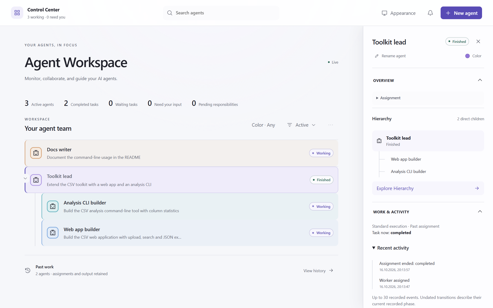
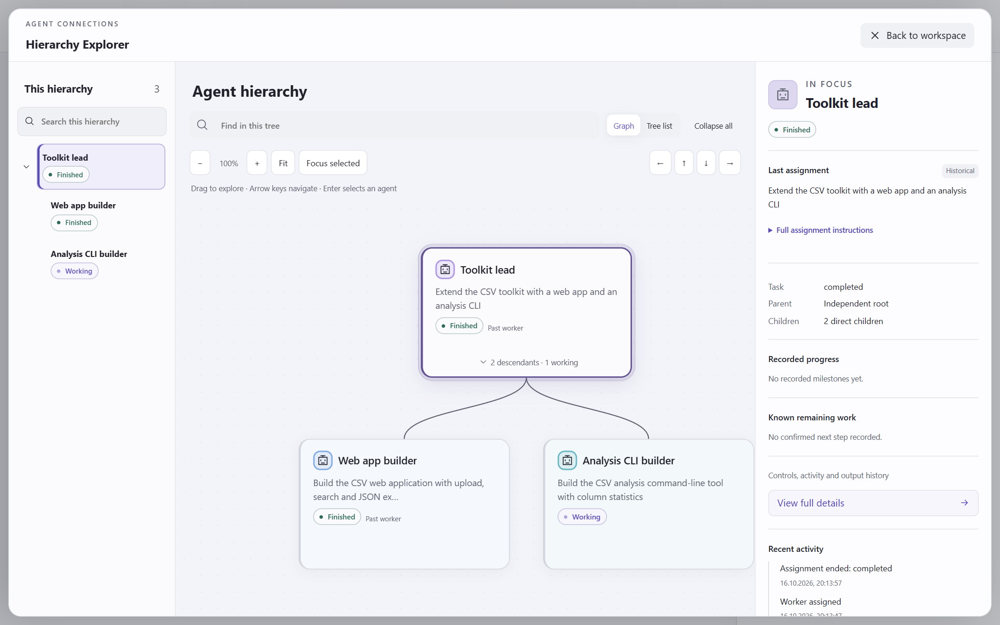
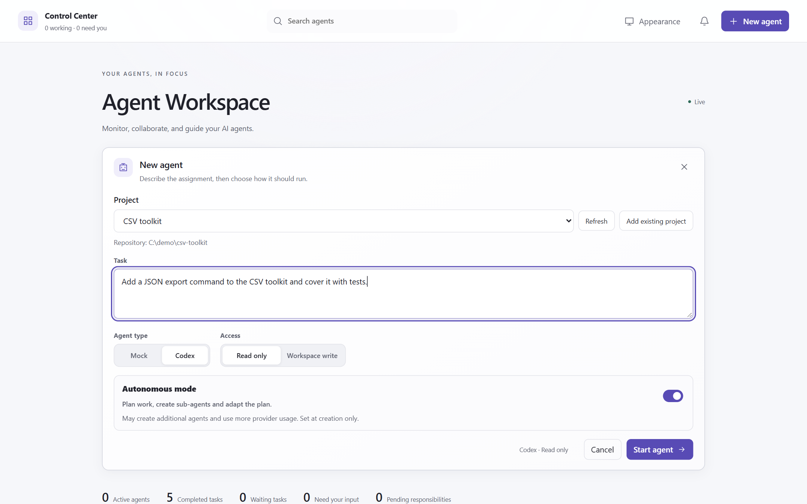
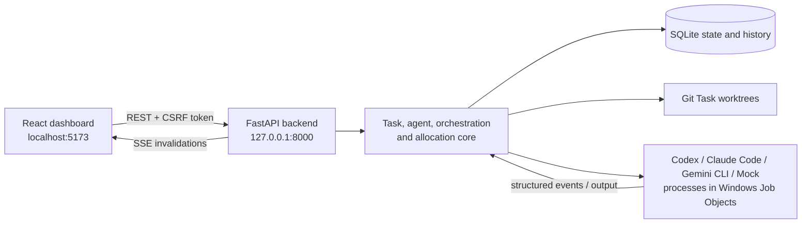

# AI Agent Control Center

A local platform for orchestrating, monitoring and controlling AI coding agents on your own machine. You describe the work in plain language. The Control Center starts the agent in an isolated Git workspace, streams its output, lets you answer its questions, redirect it or stop it, and keeps a durable record of what happened.

A chat window gives you one model and one conversation. The Control Center instead treats work as **Tasks** owned by **Agents**: a Parent agent can split a request into separate responsibilities, the backend admits **Child agents** under explicit limits, each Child works in its own workspace, and its result comes back only through conflict-checked integration and the Parent's explicit acceptance. Different agents in one hierarchy can run on different providers, models and reasoning efforts.

> **Status:** an open-source engineering project under active development, run locally on Windows. It is not a production service. The [OpenAI Codex CLI](https://github.com/openai/codex) is the provider verified with real runs. Claude Code and Gemini CLI adapters are implemented and tested against fake CLIs; authenticated end-to-end runs with them have not been performed yet. A Mock provider lets you explore the UI without model usage. See [providers](docs/providers.md) and [limitations](#current-limitations).



<sub>Illustrative screenshot made with Mock agents and a demo repository, taken before multi-provider support was added. The hierarchy was created manually through the API, so it does not record an autonomous run.</sub>

## Why it exists

Running several coding agents in separate terminals breaks down quickly. It becomes hard to see which agent is waiting for you, two agents can edit the same files, and nobody records which output was actually reviewed or merged. If a terminal closes, its history is gone.

The Control Center puts that work behind one local backend:

- **One place to watch and steer.** Every agent's status, output and pending question is in one dashboard. You can reply, redirect, stop a single agent or stop a whole branch.
- **Isolation by default.** Each Task gets its own Git worktree snapshot, so agents never edit your checkout directly.
- **Explicit hand-offs.** Child results are integrated only through journaled, conflict-checked steps and explicit acknowledgement, never by trusting an agent's claim that it is done.
- **Durable state.** Tasks, assignments, plans, delegations, allocation decisions, integrations and output live in SQLite and survive backend restarts.

## What it does

**Agents and Tasks**
- First-class, durable Task and Agent identities: work survives a worker being replaced, and stale workers cannot write.
- Start agents against a registered local Git repository (Project). Reply to a waiting agent, redirect a running one, delegate routine decisions, stop an agent or its whole subtree, and resume work after an interruption.
- Remove an agent or a whole branch while preserving its Tasks, and transfer responsibility to a new owner explicitly.
- Pause, resume and cancel with subtree impact, dependencies and durable blockers; resource claims with fair queues and deadlock detection; work-intent scopes that detect overlapping responsibilities.

**Autonomous orchestration (Codex, and Claude Code with fake-CLI verification)**
- The Parent records an orchestration decision: work independently with a rationale, or propose separate Child responsibilities with their dependencies.
- Proposals are promoted through a strict JSON protocol. The backend alone decides admission, applying depth, capacity, scope-overlap, resource and lifecycle checks. Provider-native sub-agent tools are disabled for these runs.
- Children work in workspaces derived from their Parent; results are integrated into the Parent's workspace and delivered for review. The Parent cannot complete until it accepts or rejects each result.

**Providers, models and effort**
- One adapter contract for Codex, Claude Code and Gemini CLI, plus Mock. Readiness (installed, signed in, enabled, billing route, usage limits) is shown with the next step when a provider is unavailable.
- Per-agent model and reasoning effort, chosen from the models the provider CLI reports for your account; unavailable models stay visible but disabled with the provider's reason. A one-time override can change model or effort for a single instruction.
- Usage awareness: provider-reported limits block new work, a run that reaches a limit waits with its Task, output and session preserved, and work resumes only when you choose Resume.
- **AI Providers** view: installation, sign-in, enablement, permission, billing, models and updates per provider; reviewed install, update, sign-in and sign-out operations that run only after you approve the exact operation (supervised, never while that provider's agents run); daily update checks with in-app notices; and hard provider permissions, global and per Task subtree, with defaults for new agents.

**Quality-first Auto allocation**
- For delegated Children, you can let the backend choose the provider, model and effort among the providers you allow. Suitability for the specific work comes first (from the Parent's assessment or your per-category profile); usage only separates comparably suitable candidates. Without evidence, the work waits instead of being downgraded.
- Works for promoted proposals and for ordinary delegation through the versioned `control-center.delegation.v3` protocol, which also supports explicit provider, model and effort requests.
- Per-Task policies with allowed providers and models, preference order and suitability profiles, inherited by subtrees with local overrides; edits are revision-checked. Every decision is recorded with an explanation in the inspector.

**Dashboard (React)**
- Live status over Server-Sent Events with polling as a fallback, and paginated output history.
- A three-pane hierarchy view with Task state, planning decisions, Child outcomes, integration evidence and recent activity.
- An inspector for each agent: provider and model settings, provider waits, allocation decisions, process ownership and removal.
- An attention panel, light, dark and automatic themes, and optional browser or Windows notifications.

<table>
  <tr>
    <td width="50%"></td>
    <td width="50%"></td>
  </tr>
  <tr>
    <td><sub>Hierarchy Explorer. Mock agents with demo data.</sub></td>
    <td><sub>An earlier version of the New agent form (Codex and Mock only); the current form also offers Claude Code, Gemini CLI, model and effort selection, and Auto allocation for Children.</sub></td>
  </tr>
</table>

A real autonomous run with Codex has been verified end to end. A natural-language request led one Parent to promote two Children. Both Children completed, both results were integrated and accepted, and the Parent finished after its own test run passed. The [verification notes](docs/dashboard.md#verification) list exactly what was and was not covered.

## Supported providers

| Provider | Status |
| --- | --- |
| OpenAI Codex CLI | Verified with real runs (tested with Codex CLI 0.154.0). Autonomous orchestration and delegation. |
| Anthropic Claude Code | Implemented; tested with fake CLIs only. Model discovery was checked against the installed CLI without a model request. Autonomous orchestration supported. |
| Google Gemini CLI | Implemented; tested with fake CLIs only. Can run as a delegated Child but cannot coordinate Children. A specific model cannot be enforced by Gemini CLI, so only Auto routing or its default model can be selected. |
| Mock | Simulated work for development and UI exploration; no model is used. |

Each real provider uses the CLI you installed and signed in to on your own machine, under your own plan. The Control Center contains no credentials, never uses API keys and never buys credits; Claude Code and Gemini CLI stay disabled until you enable them and confirm their billing route. Available models and limits depend on your account. Details: [providers](docs/providers.md).

## Architecture



- **Frontend:** React 19, Vite 8 and plain CSS. Tests run on Node's built-in test runner.
- **Backend:** Python, FastAPI, Uvicorn, SQLite and standard-library process and thread management. No ORM and no task queue.
- **Provider adapters:** one contract for locating, checking, launching and parsing each CLI. The prompt is sent on stdin, and only validated, fixed CLI options are passed as arguments. Lifecycle, admission, supervision and recovery stay in the backend.
- **Orchestration:** planning, promotion, delegation, allocation, materialization and integration are durable, journaled steps with idempotent identities, rechecked at every admission boundary.
- **Single process:** run one backend process. Live process registries and the event broker are in memory.

## Engineering highlights

These are the problems that took most of the design work. The linked documents explain the invariants in detail.

| Problem | Approach |
| --- | --- |
| Agents claiming work they did not do | Control messages are accepted only from validated, completed structured assistant events. Prose, tool output, stderr and code fences cannot request delegation or acknowledge results. See [delegations](docs/delegations.md). |
| Ownership after crashes and replacements | Work is owned by Task assignments and execution generations. Stale workers cannot write, and uncertain launches are marked `recovery_required` instead of being retried blindly. See [task lifecycle](docs/task-lifecycle.md). |
| Parallel agents editing the same code | Each Task gets a detached worktree snapshot. Integration checks freshness, stages changes outside the destination, keeps a journal and refuses conflicts. See [workspaces](docs/workspaces.md). |
| Unbounded multi-agent fan-out | Depth, unfinished-Children and concurrency limits are checked at every admission and launch, together with per-tree round rate limits and non-overlapping responsibility scopes. See [delegations](docs/delegations.md#depth-and-operational-bounds). |
| Choosing models without guessing | Auto allocation applies hard eligibility first (policy, entitlement, billing route, usage limits), then evidence-based suitability, and uses usage only as a tie-breaker. The user's current policy is rechecked inside the final admission transaction. See [providers](docs/providers.md#auto-allocation-for-delegated-children). |
| Orphaned processes | Each execution runs in a Windows Job Object that kills its whole tree on Stop, shutdown or backend crash, and launch fails closed if supervision cannot be established. When an end cannot be proven, the Task stays held, and the inspector offers a recorded human attestation only when fresh diagnostics allow it. See [process supervision](docs/process-supervision.md). |
| Local API exposed to the browser | Host and Origin checks, a per-process CSRF token and JSON-only bodies block other websites. GET requests have no side effects. See [API security](docs/api-security.md). |

## Quick start (Windows)

The backend and the frontend are started separately; there is no installer or one-click launcher yet. The commands below are PowerShell. Run them in order: each block assumes the directory left by the previous one.

### 1. Prerequisites

- **Windows 10 or 11.** Agent launching and process supervision are Windows-only for now; on other platforms launches are refused with `Process supervision unavailable`.
- **Git**, on `PATH`, with `user.name` and `user.email` configured.
- **Python 3.11 or newer**, available as `python`.
- **Node.js 22.13+ or 24+**, with npm.
- **For real agents only:** an account that can use the provider CLI you choose. Mock mode needs no account.

Check what you have:

```powershell
git --version
python --version
node --version
npm --version
```

### 2. Clone the repository

Choose a parent folder, for example your home directory:

```powershell
cd $HOME
git clone https://github.com/amit22882036-ship-it/ai-agent-control-center.git
cd .\ai-agent-control-center
```

The rest of the setup runs from this repository root.

### 3. Create the Python virtual environment

```powershell
python -m venv .venv
```

The commands below call `.venv\Scripts\python.exe` directly, so you do not need to activate the environment.

### 4. Install backend dependencies

```powershell
.\.venv\Scripts\python.exe -m pip install -r backend\requirements.txt
```

### 5. Install frontend dependencies

```powershell
cd .\frontend
npm ci
cd ..
```

### 6. Install and sign in to a provider CLI (real agents only)

The Control Center uses whatever account is signed in on **your** machine. Model usage is billed to, or counted against, your own plan. For Codex:

```powershell
npm install -g @openai/codex
codex login
codex login status
```

`codex login` opens a browser so you can sign in. The backend launches Codex through npm's global launcher at `%APPDATA%\npm\codex.cmd`, which is where `npm install -g` puts it by default; if you changed npm's global prefix, real agents report that Codex was not found.

Claude Code (`%USERPROFILE%\.local\bin\claude.exe` or `%APPDATA%\npm\claude.cmd`) and Gemini CLI (`%APPDATA%\npm\gemini.cmd`) are installed and signed in with their own official instructions, or from **AI Providers** in the top navigation: it shows what is missing and offers reviewed install, update, sign-in and sign-out operations that run only after you approve them (Gemini CLI's sign-in and Claude Code's native installer stay manual steps). AI Providers is also where you choose which providers agents may use. Their supported sign-in routes and billing checks are described in [providers](docs/providers.md).

No Control Center configuration is required. Optional settings are listed in [configuration](docs/configuration.md).

### 7. Start the backend (window 1)

Open a PowerShell window in the repository root and keep it running:

```powershell
cd .\backend
..\.venv\Scripts\python.exe -m uvicorn app.main:app --host 127.0.0.1 --port 8000
```

When Uvicorn prints `Application startup complete`, the API is ready. You can confirm it at <http://127.0.0.1:8000/health>.

### 8. Start the frontend (window 2)

Open a **second** PowerShell window in the repository root and keep it running:

```powershell
cd .\frontend
npm run dev -- --host 127.0.0.1 --port 5173 --strictPort
```

### 9. Open the dashboard

Go to <http://127.0.0.1:5173>.

| Port | What runs there | Used for |
| --- | --- | --- |
| `5173` | Vite dev server for the React dashboard | The page you open in the browser |
| `8000` | FastAPI backend | REST API, live events, local API docs at `/docs` |

The dashboard always calls the backend at `127.0.0.1:8000`, so the backend must run on that port. Both servers listen only on `127.0.0.1`.

### 10. Register an existing Git project

Agents work on a registered Project, which must be an existing Git repository with at least one commit. For a first try, create a small sandbox repository in a third window:

```powershell
mkdir $HOME\control-center-sandbox
cd $HOME\control-center-sandbox
git init
Set-Content README.md "# Sandbox"
git add README.md
git commit -m "Initial commit"
```

In the dashboard, choose **New agent**, then **Add existing project**. Enter a name and the repository's absolute path, for example `C:\Users\<you>\control-center-sandbox`, and choose **Register project**.

Agents never edit this folder directly. Each Task works in its own snapshot under `%LOCALAPPDATA%\AI Agent Control Center\task-workspaces`, and changes come back only through integration.

### 11. Start a Mock agent

In **New agent**, select your Project and choose **Mock**. Enter any short assignment and start the agent. Mock agents simulate progress and output so you can try Stop, the output view and the hierarchy. They do not run the assignment and use no model.

### 12. Start a real agent

In **New agent**, choose a ready provider, optionally a model and effort, and keep **Read only** access for a first run. Turn **Autonomous mode** off unless you want the agent to be able to create Child agents: it is on by default for new Codex and Claude Code root agents, and autonomous runs can use noticeably more model usage. Enter a request in plain language, for example:

```text
Summarize what this repository contains and suggest one small improvement.
```

Choose **Workspace write** only when you want the agent to change files in its isolated Task workspace.

### Stopping and restarting

Press `Ctrl+C` in each window, then run the commands from steps 7 and 8 again. Stopping the backend also stops any running agents. History stays in the database, but running work does not resume automatically.

If the backend window ever had environment variables set for an experiment, such as `CONTROL_CENTER_DB_PATH` for a test database or the delegation limits, the dashboard will use those settings until they are cleared. Before restarting the backend for normal use, check:

```powershell
Get-ChildItem Env:CONTROL_CENTER_*
```

Clear any you did not intend to keep, for example `Remove-Item Env:CONTROL_CENTER_DB_PATH`, or open a new PowerShell window. [Troubleshooting](docs/configuration.md#troubleshooting) covers port conflicts and other common problems.

## Configuration

Everything has a working default, and environment variables are read by the backend at startup. You can relocate the database or the workspace root, set Codex defaults, adjust the model-catalog cache and tighten delegation limits. All settings are listed in [configuration and troubleshooting](docs/configuration.md) and [providers](docs/providers.md).

## Current limitations

- **Under active development.** Real-provider end-to-end validation is not complete: Claude Code and Gemini CLI, multi-provider hierarchies and Auto allocation have been exercised with fake CLIs and isolated databases, not with authenticated accounts.
- **Gemini model selection.** Gemini CLI documents no way to disable its model fallback and does not report which model produced a response, so selecting a specific Gemini model is refused; only Auto routing or its default model run.
- **Local and single-user.** The backend has no user authentication. Its [local API guards](docs/api-security.md) block other websites, but any program running as your Windows user can call it. Do not expose it to a network. Production security and deployment have not been validated.
- **Windows only for real agents.** Launching and Job Object supervision are implemented and tested on Windows. Other operating systems are not a supported target.
- **Model usage costs.** Real agents use your provider plan, and autonomous runs can start several agents and continuations. The Control Center has no token or spending budget, never estimates usage, and resumes after a usage limit only when you choose Resume. Billing checks reduce, but cannot eliminate, the risk of provider charges.
- **Ordinary delegation.** Ordinary (non-Hybrid) delegations have no review or acknowledgement protocol for their results; the reviewed path is autonomous orchestration with promotion and Hybrid continuation. See [delegations](docs/delegations.md).
- **Sandboxes and workspaces are boundaries, not guarantees.** Provider permission modes are enforced by each CLI. Task worktrees share repository history, and snapshots exclude common secret and build paths by filename, but this is not a secret scanner. Symlinks and submodules are not supported in Task snapshots.
- **Private runtime data.** Prompts, agent output and workspace paths are stored in `data/control_center.sqlite3` and the task-workspace folder. Both are excluded from Git. Do not publish them.
- **Tested, not guaranteed.** The automated suites use mocks, fake provider CLIs, process shims and real temporary Git repositories. Agent status does not prove that an agent's work is correct, so review results before relying on them.
- **Provider setup.** Setup operations in AI Providers are Windows only and were tested with a fake npm and fake CLIs, not by installing or signing in to real CLIs. Provider permissions apply globally and per Task subtree; there are no project-level permissions.
- **UI coverage.** Some controls exist only as API endpoints, including Task lifecycle, resources, work intents and integration. The UI has no separate Project or Task management screens.

## Roadmap

- **Real-provider integration testing:** authenticated end-to-end runs with Claude Code and Gemini CLI, and mixed-provider hierarchies.
- **User experience redesign and production readiness (Stage 2J):** a substantial redesign of the interface and workflows, not only visual polish.
- **Convenient launch and presentation (Stage 2K):** a simpler way to start the application on the desktop (the packaging approach is not decided yet) and a project demonstration video.

## Development

Run the checks from the repository root:

```powershell
cd .\backend
..\.venv\Scripts\python.exe -B -m unittest discover -s . -p "test_*.py"
cd ..\frontend
node --test tests/*.test.mjs
npm run lint
npm run build
cd ..
git diff --check
```

The full backend suite takes about 30 minutes on Windows. It uses temporary databases, repositories and fake provider CLIs and never starts a real provider. For backend development you can add `--reload` to the Uvicorn command. Do not use it while agents are running, because a reload restarts the backend and stops them.

[AGENTS.md](AGENTS.md) holds the repository rules that coding agents follow when working on this project.

## Documentation

| Document | Covers |
| --- | --- |
| [Configuration and troubleshooting](docs/configuration.md) | Environment variables, state locations, delegation limits and common problems |
| [Dashboard](docs/dashboard.md) | Autonomous creation, the managed execution policy, the hierarchy explorer and verification |
| [Planning and promotion](docs/planning.md) | Orchestration decisions, proposals and promotion to Child Tasks |
| [Providers](docs/providers.md) | Provider adapters, readiness, billing and usage policy, the model catalog, per-agent model and effort, Auto allocation, AI Providers setup and updates, provider permissions and mixed hierarchies |
| [Delegations](docs/delegations.md) | Request protocol, Child materialization, result delivery, recursion and limits |
| [Task lifecycle](docs/task-lifecycle.md) | Task identity, assignments, controls, dependencies and recovery |
| [Agent removal](docs/agent-removal.md) | Removing an Agent or a whole branch while preserving Tasks, and transferring responsibility |
| [Workspaces and integration](docs/workspaces.md) | Projects, worktree snapshots, freshness and conflict-aware integration |
| [Resource coordination](docs/resource-coordination.md) | Resource claims, fairness, deadlocks and work intents |
| [Process supervision](docs/process-supervision.md) | Windows Job Object containment, Stop semantics, restart recovery, diagnostics and human attestation |
| [Local API security](docs/api-security.md) | Host and Origin checks, CSRF token and scripting the API |
| [Project history](docs/history/stage1-handoff.md) | The Stage 1 technical checkpoint and earlier design decisions |

## License

Released under the [MIT License](LICENSE). The software is provided as is, without warranty. Using real agents also falls under the terms of the provider you use.
