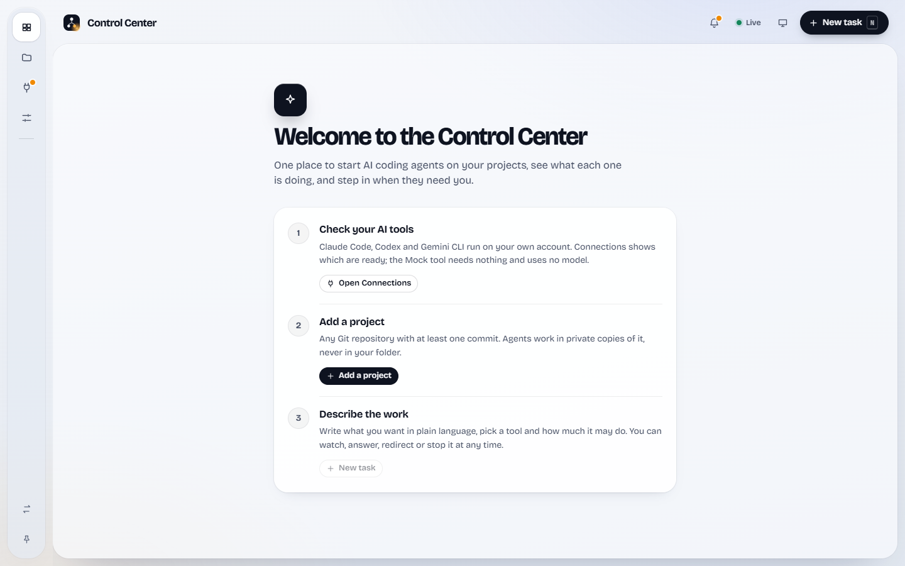

# Windows desktop app

The desktop app is Electron around the existing backend. The backend is packaged with PyInstaller
(`ControlCenterBackend.exe`) and serves the interface itself, so the window, the API and the live
updates share one local origin on a free `127.0.0.1` port. Nothing else listens.

## Why Electron with a packaged Python backend

The backend's process supervision (Windows Job Objects), provider discovery and SQLite stay exactly
as they are; the shell only starts and stops one child process. Electron gives a stable Chromium
for the interface, a native folder picker, a tray and an NSIS installer from one build, without a
Rust toolchain. The cost is installer size (about 100 MB).

## Behaviour

- **Single instance**: a second launch focuses the existing window.
- **Startup**: a splash while the service starts; if it fails, a message names the log folder.
- **No console windows**: the backend runs with a hidden console that its agents and Git inherit.
- **Closing**: with agents working, the app asks whether to keep them working in the background
  (tray icon) or quit. Quitting asks the backend to shut down (agents stopped and recorded, the
  database closed). If the app itself ends, the backend sees its input close and shuts down too.
- **Links**: anything that is not the local interface opens in the default browser.

## Data

| What | Where |
| --- | --- |
| Database | `%LOCALAPPDATA%\AI Agent Control Center\control_center.sqlite3` |
| Task worktrees | `%LOCALAPPDATA%\AI Agent Control Center\task-workspaces` |
| Trash | `%LOCALAPPDATA%\AI Agent Control Center\Trash` |
| Logs | `%LOCALAPPDATA%\AI Agent Control Center\logs` |
| Demo mode (`--demo`) | `…\AI Agent Control Center\demo\` (separate database) |

Uninstalling removes the program, shortcuts and registry entry and keeps this data. The desktop
app does not read the development database in `data\`.

Provider CLIs (Claude Code, Codex, Gemini CLI) are not bundled: install and sign in to them as
usual; the app finds them in the same places as the development backend.

## Build

From the repository root in PowerShell: `.\desktop\build.ps1`. It builds the interface
(`npm run build:desktop`), a separate Python environment in `desktop\.venv` with PyInstaller, the
packaged backend, and the installer in `desktop\out\`. The installer is unsigned, so Windows
SmartScreen warns before the first run.

## First run and demo mode

A new installation opens on a welcome with three steps: check the AI tools in Connections, add a
project (the system folder picker fills the path and a name), and describe the work. Starting the
app with `--demo` uses a separate database with three synthetic repositories and Mock agents, so
it can be explored without a real project or any model usage.

## Verified on this machine

All with disposable data (`CONTROL_CENTER_DESKTOP_DATA` and `APPDATA` pointed at temporary
folders, fake provider CLIs, Mock agents only; no real project, database or paid run):

| Check | 0.9.0 (2026-11-05) | 0.9.1 upgrade (2026-11-05) |
| --- | --- | --- |
| Silent install (`/S`), Start menu and desktop shortcuts, per-user uninstall entry | Yes | Yes, over 0.9.0 |
| Launch; backend healthy on a free port; interface served; window shown | Yes | Yes |
| Process supervision reported as `supervised`; a Mock agent started and finished | Yes | Yes |
| Provider discovery: Codex and Gemini CLI found at the fake installation | Yes | Yes |
| Data kept across the upgrade (project, task, agent history) | Not applicable | Yes |
| Closing the window: backend shutdown completes, exit code 0, no process left | Yes | Yes |
| Silent uninstall removes program, shortcuts and registry entry; data stays | Yes | Yes |

Claude Code discovery found the developer's own native installation (its location is under the
user profile, which the test cannot redirect without breaking Electron); only local, non-billable
discovery ran against it. The installer is not code-signed, and automatic in-app updates are not
implemented: a newer version is installed over the old one, as verified above.
